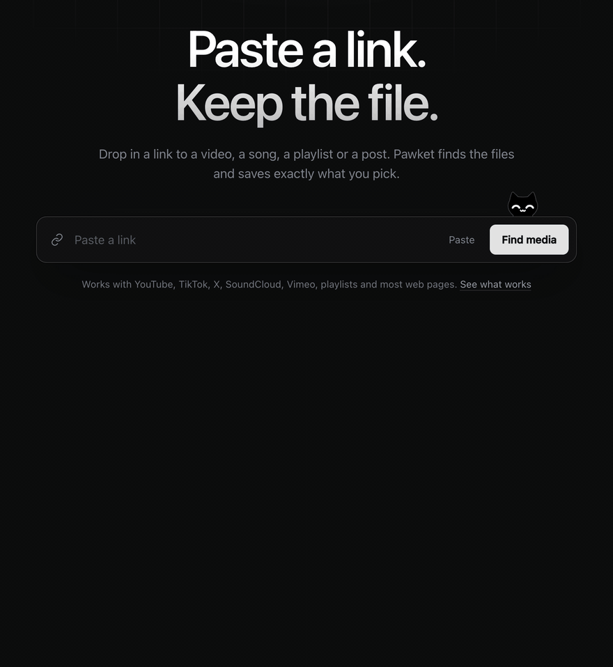

# Pawket

**put it in ur pawket.**

Found a track you want to keep? Paste the YouTube link and hit **Save MP3**. Now you can play it offline. Want the video too? Save an MP4. No account needed.

**2.83 seconds from link to finished MP3** was Pawket’s median across 11 YouTube videos and Shorts on a Mac mini. The yt-dlp CLI took 8.65 seconds on the same links in a separate run. [See every timing and the test setup](docs/BENCHMARK.md).

**[Download for Windows](https://github.com/repo-ing/pawket/releases/latest/download/Pawket-Setup.exe)** · **[Download for Apple silicon Mac](https://github.com/repo-ing/pawket/releases/latest/download/Pawket-for-Mac.zip)** · [Intel Mac and Linux](https://github.com/repo-ing/pawket/releases/latest)

## Download Pawket

| Your computer | Download | Open it |
| --- | --- | --- |
| **Windows 10 or 11** (64-bit Intel or AMD) | **[Download for Windows](https://github.com/repo-ing/pawket/releases/latest/download/Pawket-Setup.exe)** | Double-click **Pawket-Setup.exe** and choose **Finish**. Next time, open **Pawket** from Start. |
| **Mac with an M1 or newer chip** (macOS 14+) | **[Download for Mac](https://github.com/repo-ing/pawket/releases/latest/download/Pawket-for-Mac.zip)** | Open the ZIP, then double-click **Pawket**. |
| **Intel Mac or Linux** | [Other downloads](https://github.com/repo-ing/pawket/releases/latest) | Extract the ZIP and follow **START.md** inside. |

The Windows installer and Apple silicon Mac app include the media tools. Pawket opens in your web browser. On Windows, leave the Pawket window running while you download.

## Save your first file

1. Copy a public video link and paste it into Pawket.
2. Click **Save MP3** for audio. For video, click **Find media**, choose **Video**, then **Save**.
3. Click **Open folder** to find your file.

**Save original audio** keeps the source audio track in its existing format when available. [Installation guide](https://repo-ing.github.io/pawket/)

## Common questions

**Where did my file go?** In Pawket, click **Open folder**. Files go to **Downloads/Pawket** by default. Click **Choose folder** once to change it. Choose a folder your cloud drive already syncs to see your saves on your other devices.

**Why did my computer show a security prompt?** These builds are unsigned on Windows and not notarized on Mac. Check that your download came from this repository’s [official releases](https://github.com/repo-ing/pawket/releases). On a Mac, see [Apple’s first-launch instructions](https://support.apple.com/en-us/102445).

**Which links work?** Pawket supports public videos, playlists, music and direct media links. Availability depends on the site and the post. Some posts require a login. DRM-protected videos and live streams are unsupported. [See supported sources and limits](docs/GUIDE.md#what-works).

## More ways to use Pawket

[Chrome extension](docs/GUIDE.md#chrome-extension) · [Command line](docs/GUIDE.md#cli) · [MCP for agents](docs/GUIDE.md#agent-mcp) · [HTTP API](docs/API.md) · [Build from source](docs/GUIDE.md#build-from-source)
